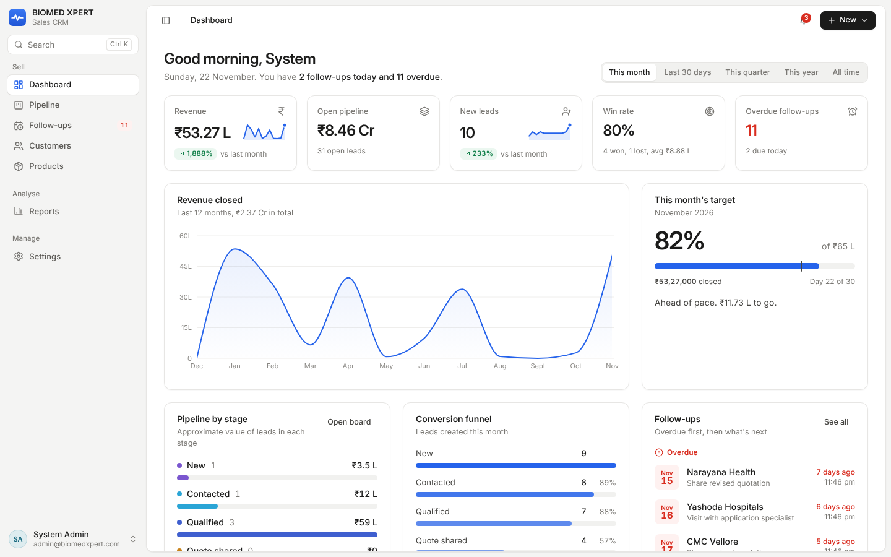
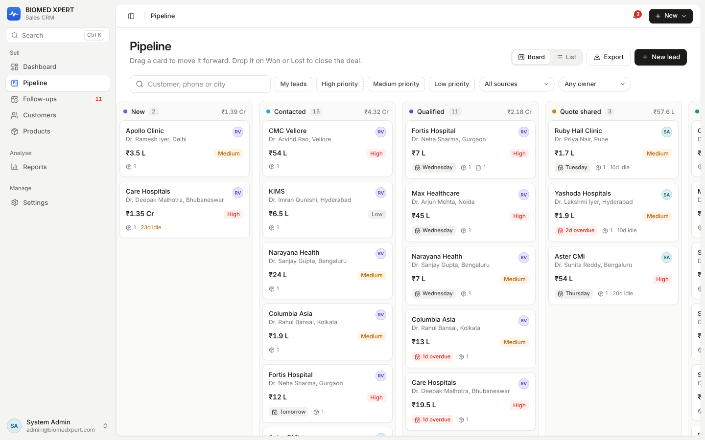
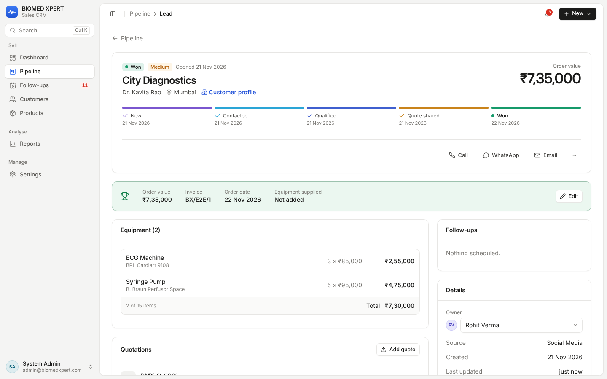
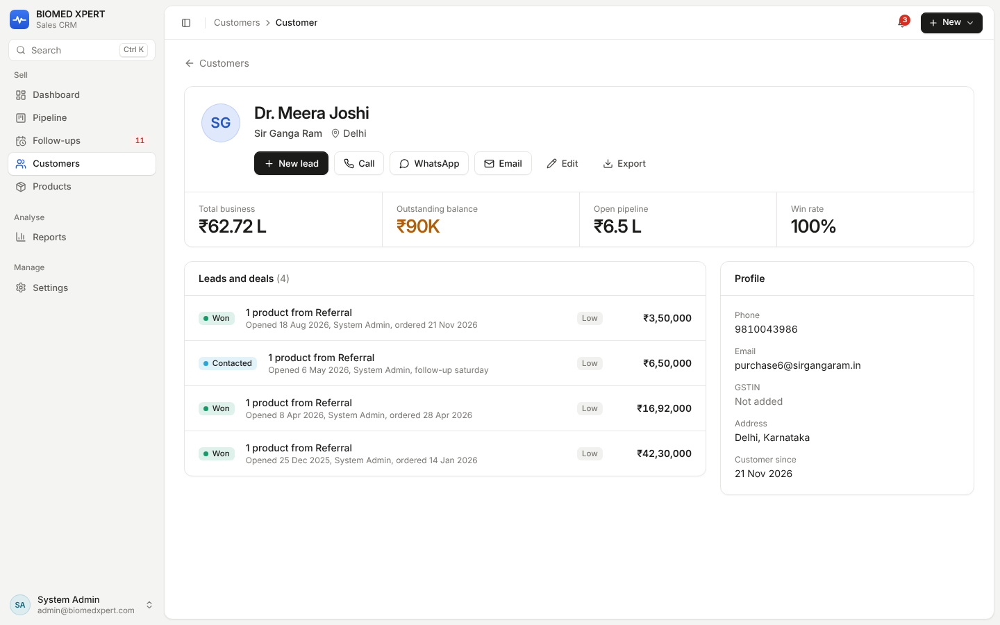
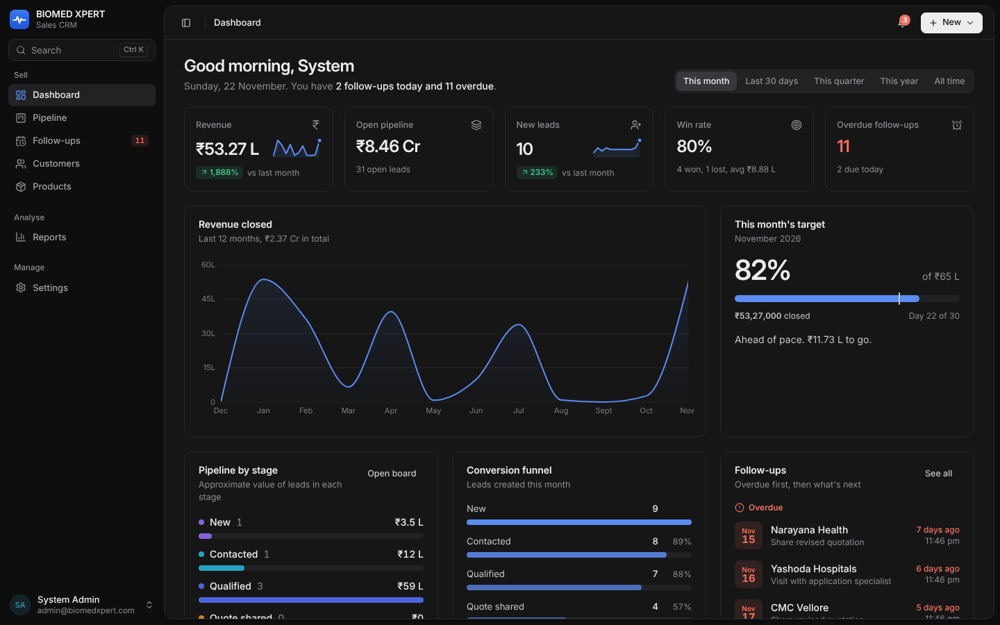
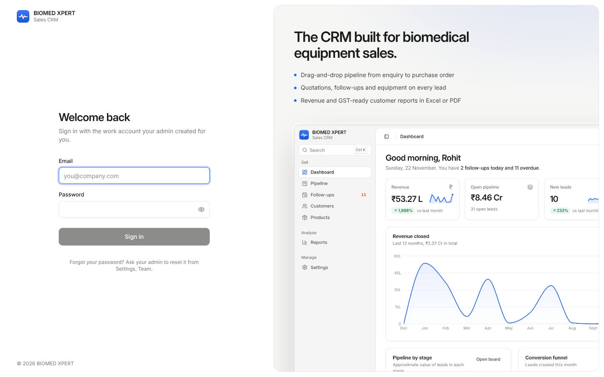
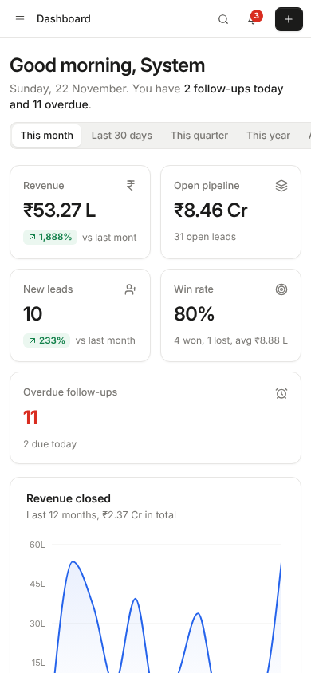

# BIOMED XPERT Sales CRM

A sales CRM for teams selling biomedical equipment to doctors, clinics and hospitals. Track every enquiry from first call to purchase order: customers, a drag-and-drop pipeline, equipment lines, quotations, follow-ups, won and lost deals, and revenue reports in Excel, CSV or PDF.



## Design

The interface follows the calm, neutral style of today's most respected work tools, Linear and Attio, built with shadcn/ui-style components:

- A dim sidebar sits on the app background, and each page lives in a raised, rounded panel, so content leads and navigation recedes.
- Warm, low-saturation grays, one blue accent, and near-black primary buttons.
- Inter, with its display optical size for headings and tabular figures for numbers.
- Hairline borders, soft avatars, and as few icons and separators as possible.
- Every dashboard number comes with a trend or a target, and the board leads with the pipeline (the HubSpot and Pipedrive pattern).
- Light, dark and match-device themes.

## Motion and shortcuts

- Numbers count up, charts and bars grow in, and sparklines draw themselves. Dialogs, menus and toasts animate in and out.
- Pipeline cards glide to their new column the moment you drop them, and winning a deal sets off confetti.
- Sliding highlights for the active page, tabs and segmented controls, plus a circular reveal when you change theme.
- Shortcuts: `N` new lead, `G` then `D`/`P`/`F`/`C`/`O`/`R`/`S` to jump between pages, `?` to list them all, `Ctrl/Cmd+K` to search.
- Everything respects the reduced-motion accessibility setting.

## Hover for exact detail

Compact figures are there for scanning; the precise numbers are one hover away. Resting the pointer on a KPI card, a stage bar, a funnel step, a source, a customer, the target meter, a date or a lead card opens a panel with the exact amounts and the figures behind them. Lead cards show a full preview — owner, source, equipment, quotations, next follow-up and how long the lead has been idle — without opening it.

## Features

**Dashboard**
- A "vitals" strip with revenue, open pipeline, new leads, win rate and overdue follow-ups, each compared with the same point in the previous period.
- 12-month revenue trend with an optional monthly target line, plus a target meter that shows whether the month is on pace.
- Pipeline value by stage, a conversion funnel, lead-source performance, top customers, reasons deals are lost, team performance and recent activity.
- Period switcher: this month, last 30 days, this quarter, this year, all time.

**Pipeline**
- Kanban board: drag a card to move it forward. While you drag, Won and Lost targets float at the bottom of the screen, so you can close a deal without scrolling sideways.
- A list view with stage tabs, sorting and pagination.
- Filters for my leads, priority, source and owner, all kept in the URL so a view can be bookmarked or shared.
- Cards show value, priority, owner, the next follow-up (flagged when overdue), product and quote counts, and how long the lead has been idle.

**Lead workspace**
- Stage tracker with dates, a note on every stage change, and a full history.
- Editable equipment lines with quantity and per-lead price, plus one click to set the deal value to the equipment total.
- PDF quotation uploads, follow-ups with notes, owner reassignment, and editable won and lost records.
- Call, WhatsApp and email buttons, and an Excel export of the lead.

**Customers**
- A full profile for each customer: lifetime business, outstanding balance, open pipeline, win rate and every lead.
- CSV import from Excel or Google Sheets, which skips duplicates and reports problems row by row. Excel export of the customer list.
- GSTIN and PIN code validation, and Indian state suggestions.

**Also**
- Follow-ups agenda: overdue, today, next 7 days, upcoming and done, for everyone or just you.
- Global search and a command menu (Ctrl+K or Cmd+K, or press `/`) across customers, leads and products, with quick actions.
- In-app notifications when a deal is won or lost, a lead moves stage, or a lead is assigned to you.
- Settings for organisation details and the monthly target, team management (add teammates, change roles, reset passwords, deactivate), lead sources, and appearance.
- Light, dark and match-device themes, a responsive layout with a mobile navigation drawer, and keyboard-accessible dialogs.
- Reports: revenue (by month or customer), leads, customers, sales by teammate and a monthly summary, filtered by date range including the Indian financial year.

| | |
|---|---|
|  |  |
|  |  |
|  |  |

## Architecture

```
biomed-xpert-crm/
  backend/     Node.js, Express, TypeScript, Prisma, PostgreSQL
  frontend/    React, TypeScript, Vite, Tailwind, TanStack Query, Recharts
  docs/        DEPLOYMENT.md, TESTING.md, screenshots
  docker-compose.yml   full stack: database, API, and web
```

The API follows clean architecture with a repository layer, Zod validation, JWT auth with role-based access and an Excel-first export layer. The web client is a single-page app with route-level code splitting, silent token refresh and query caching.

## Quick start with Docker

```
docker compose up --build
docker compose exec api npm run seed   # first run only
```

Open http://localhost:8080 and sign in.

## Quick start without Docker

```
cd backend
cp .env.example .env        # then edit DATABASE_URL and the JWT secrets
npm install
npm run prisma:generate
npx prisma db push
npm run seed
npm run dev
```

In a second terminal:

```
cd frontend
npm install
npm run dev
```

Open http://localhost:5173.

## Accounts

`npm run seed` creates an admin (`admin@biomedxpert.com`) and a sales user (`sales@biomedxpert.com`). Set `SEED_ADMIN_PASSWORD` and `SEED_SALES_PASSWORD` before seeding any database that others can reach. The default passwords in `prisma/seed.ts` are public. After that, admins add teammates and reset passwords from Settings, Team.

## Notes

- Money is stored as `Decimal(14,2)` and shown in rupees, with lakh and crore short forms.
- `Customer.totalValue` is recalculated from won deals, including when a won lead is deleted. `balance` is entered by hand.
- Only admins can delete leads.
- Never commit a real `.env` or connection string. `.env.example` files hold placeholders only.

See `docs/DEPLOYMENT.md` for hosting (including Vercel and Render) and `docs/TESTING.md` for end-to-end checks.
